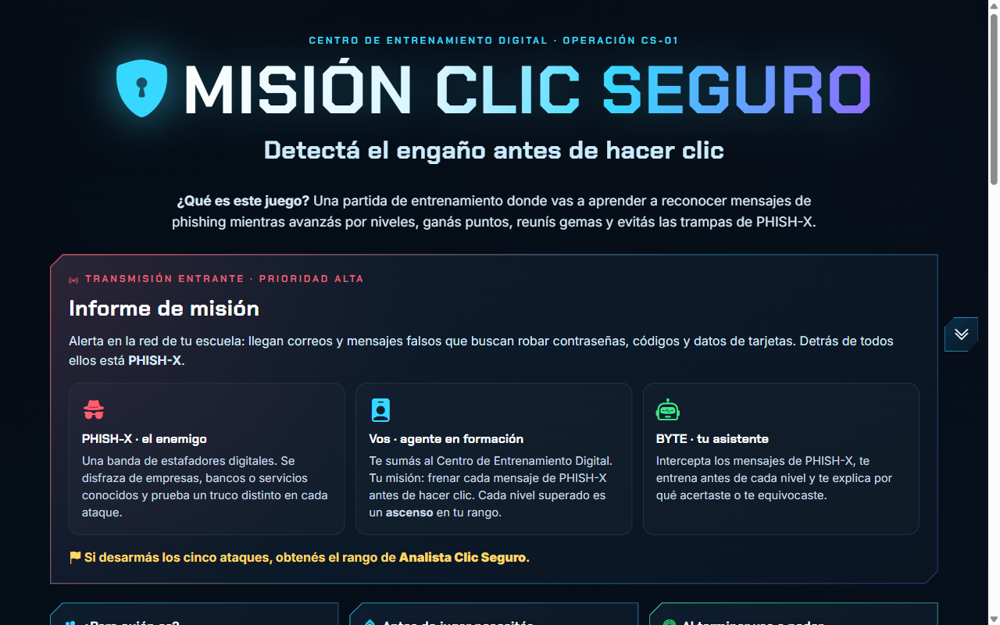
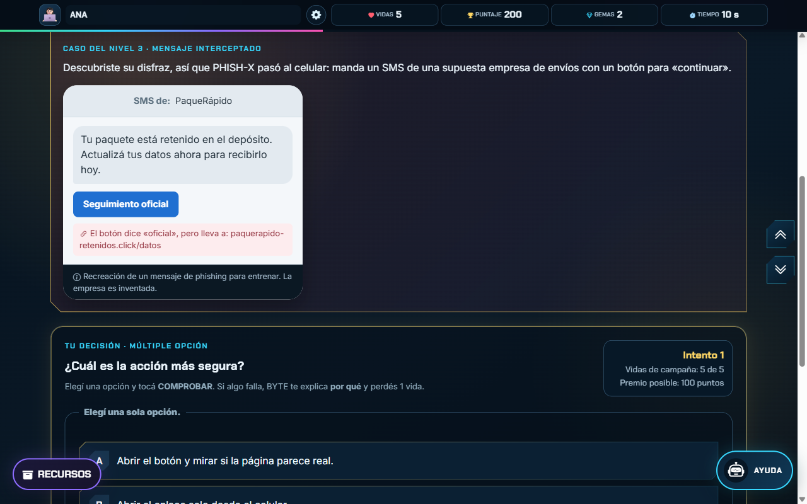

# Misión Clic Seguro

Aprendé a detectar mensajes de phishing antes de hacer clic, en cinco niveles.

Objeto de Aprendizaje (OA) web gamificado para estudiantes de 3.º de EBI (13 a 16 años): sos un agente en formación que frena los ataques de PHISH-X con la ayuda de BYTE, tu asistente.



## Cómo abrirlo

Descargá el proyecto y abrí `index.html` en el navegador. No necesita instalación ni servidor; solo el video de Primeros pasos pide conexión a internet.

```bash
git clone https://github.com/jsayanes/misionclicsegurosprint3.git
```

## Cómo se juega

1. Escribí tu nombre de agente, elegí un avatar y tocá **INICIAR PARTIDA** (o Enter en el nombre).
2. En **Primeros pasos** mirá el video, leé «¿Qué es el phishing?», observá las evidencias y las reglas. El reloj todavía no corre.
3. Superá los cinco niveles. Cada uno tiene un entrenamiento breve, un mensaje de PHISH-X interceptado y una decisión que se corrige al tocar **COMPROBAR**.
4. Al terminar recibís el certificado de **Analista Clic Seguro**, con tus puntajes y un código QR, listo para imprimir o guardar como PDF.



## Qué aprende el estudiante

- Detectar la **urgencia** como señal de engaño.
- Revisar el **dominio real** de quien escribe.
- Verificar un **enlace** sin tocarlo, por una ruta independiente.
- Reconocer qué **datos sensibles** nunca se comparten.
- Aplicar el **protocolo**: no interactuar, verificar, reportar y eliminar.

## Niveles y actividades

| Nivel | Señal | Actividad | Formulario |
|-------|-------|-----------|------------|
| 1 | Urgencia | Cuatro afirmaciones | Verdadero o falso (radio) |
| 2 | Remitente | Escribir el dominio real | Respuesta escrita (texto) |
| 3 | Enlaces | Elegir la acción más segura | Múltiple opción (radio) |
| 4 | Datos | Marcar los datos sensibles | Casillas (checkbox) |
| 5 | Protocolo | Ordenar los cuatro pasos | Combos (select) |

## Puntos, vidas y gemas

- **Vidas:** 5 para toda la campaña. Cada error resta una; con 0 la partida termina y se vuelve a las reglas sin perder el perfil.
- **Puntaje:** según el intento en que acertás: 100, 50, 25, 10 o 0 puntos, hasta 500.
- **Gemas y progreso:** cada nivel superado suma una gema, un 20 % de la barra y una insignia.
- **Avisos sin castigo:** si dejás algo sin responder, repetís un paso del protocolo o volvés a enviar la misma respuesta incorrecta, BYTE te avisa y no perdés vida.
- **Certificado:** muestra puntajes por nivel, tiempo total y un código de validación (por ejemplo `ACS-ABAAA-L4`) con su QR.

## Dónde está cada criterio del sprint

| Criterio | Dónde mirarlo |
|----------|---------------|
| Contenido y objetivos | Portada (público, conocimientos previos, objetivos) y «¿Qué es el phishing?» en Primeros pasos |
| Estructura HTML | `index.html`: `header`, `nav`, `main`, `section`, `footer` y un `form` por actividad |
| Narrativa | Informe de misión, casos de cada nivel, mensajes de BYTE, Game Over y certificado |
| Diseño y CSS | `styles.css`, enlazado desde `index.html`; colores y fuentes en el `:root`. Mockup en cuatro láminas: [inicio](.github/assets/mockup-1-inicio.png), [Primeros pasos](.github/assets/mockup-2-primeros-pasos.png), [nivel](.github/assets/mockup-3-nivel.png) y [cierre](.github/assets/mockup-4-cierre.png) |
| Lógica de formularios | `script.js`, sección 3 (corrección) y `comprobarNivel` |
| Feedback con el DOM | `mostrarFeedback`, `marcar` y las explicaciones por ítem en `script.js` |
| Gamificación | `resolverAcierto`, `resolverError` y `actualizarHUD` en `script.js` |

## Créditos y licencias

- Fuentes [Chakra Petch](https://github.com/m4rc1e/Chakra-Petch) e [Inter](https://github.com/rsms/inter): SIL Open Font License 1.1 (`fonts/`).
- [Bootstrap Icons](https://icons.getbootstrap.com/) 1.11.3: MIT.
- [augmented-ui](https://augmented-ui.com/): BSD 2-Clause.
- Subconjunto de [Animate.css](https://animate.style/) 4.1.1: MIT.
- Video de apoyo: [YouTube](https://www.youtube.com/watch?v=z9c0Ah_KzpY), embebido sin cookies.

Las licencias completas están junto a cada archivo en `vendor/` y `fonts/`.
